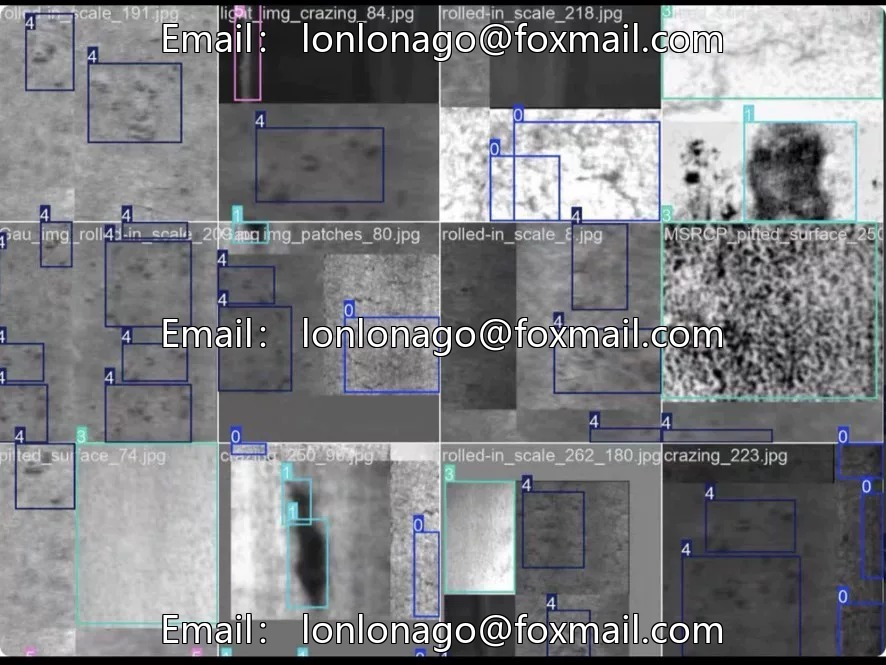
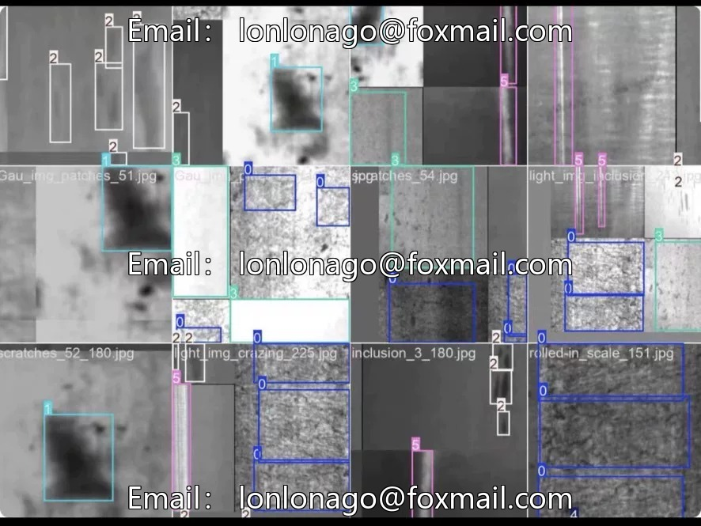
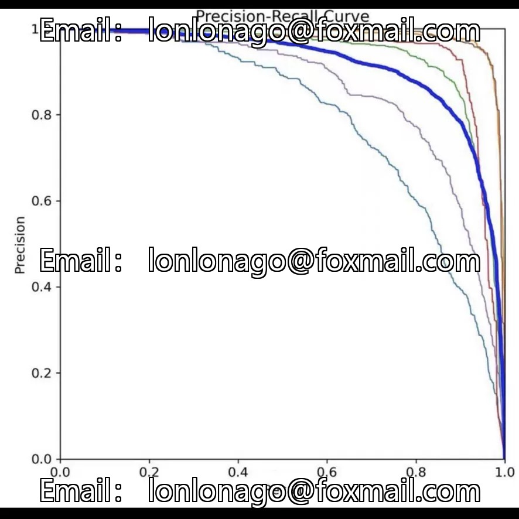

# Steel surface defect detection dataset, 9000 images in YOLO format, 6

## Body

Steel surface defect target detection dataset, 9000 images in YOLO format, 6 types of defects: rolling scales, spots, cracks, pits, inclusions, scratches, covered with oxide scale, mechanical damage, material impurities and other main causes, close to production line standards.

Industrial semantic category design, suitable for fine-grained quality classification. The dataset includes industrial scene challenges: uneven lighting, oxidation layer, oil stains, motion blur, etc. The defect scale varies greatly, ranging from tiny inclusions to long scratches. 9000 large-scale samples, support the model to deal with complex situations. It is recommended to use preprocessing methods such as frequency domain enhancement and adaptive histogram equalization during training.

Application Value: Can replace manual visual inspection, realize real-time defect detection and elimination on high-speed production line; Statistical defect distribution feedback process optimization; Automated grading and classification of auxiliary products. Task of defect detection on other metal surfaces (aluminum, copper)

YOLO format directly connects to training, suitable for industrial vision quality inspection, intelligent manufacturing, and quality traceability systems.

Virtual materials, once sold, are non-refundable.
Interested friends, click "I want" to proceed.

## Images

## Payment

Here is a pay link on Stripe ( https://buy.stripe.com/3cs8yP7sY87d0vu9AB ). Please contact me lonlonago@foxmail.com after funding $89, and I will send you a complete data files , thank you!

